  

  
  
  
  
  
  

---

# 🛒 Awesome Wholesale Sales & Operations

> A curated directory of premier **Wholesale Sales Operations**, **B2B E-Commerce Platforms**, **Order Management Systems (OMS)**, **Digital Linesheet Catalogs**, and **Self-Hosted Open-Source Commerce Engines**. Purpose-built for wholesale brands, multi-line sales rep agencies, distributors, manufacturers, and B2B software engineers.

---

## 📑 Table of Contents

- [🌐 Sector Overview & Market Dynamics](#-sector-overview--market-dynamics)
- [🏢 SaaS & Hosted Commercial Platforms](#-saas--hosted-commercial-platforms)
- [⭐ Open-Source GitHub Projects](#-open-source-github-projects)
- [🏗️ Recommended Architecture Stacks](#-recommended-architecture-stacks)
- [🤝 How to Contribute](#-how-to-contribute)
- [⭐  Star History](#--star-history)
- [💖 Support & Sponsoring](#-support--sponsoring)
- [⚖️ Disclaimer & Compliance](#️-disclaimer--compliance)

---

## 🌐 Sector Overview & Market Dynamics

The global **B2B e-commerce transaction volume** is currently estimated between **$26 Trillion and $36 Trillion** (and projected to exceed $60+ Trillion by 2030), with the specialized **Wholesale Sales Operations & B2B Commerce Software** platform spend commanding over **$14 Billion** annually (growing at an 11% to 18% CAGR).

**Market Structure & Fragmentation:** While wholesale discovery marketplaces exhibit moderate network-driven concentration (e.g., Faire dominating independent retail discovery), the broader wholesale sales operations and software layer is **highly fragmented**. Unlike consumer retail where monolithic checkout engines dominate, wholesale operations require nuanced, specialized capabilities—including tiered distributor price matrices, custom credit/Net payment terms, offline order writing at trade shows, digital visual line sheets, rep commission splitting across independent agencies, and multi-warehouse ERP/WMS synchronization—fostering a vibrant and diverse ecosystem of specialized SaaS applications and flexible open-source frameworks.

---

## 🏢 SaaS & Hosted Commercial Platforms

Below is a detailed comparison of market-leading SaaS and hosted platforms for wholesale sales and operations, **sorted in descending order by company scale (valuation or acquisition value / revenue)**.

| 🏢 Platform | 📊 Company Scale (Valuation / Revenue) | 💰 Starting Pricing | 🎁 Free Tier / Trial Limits | ✨ Key Wholesale Capabilities & Focus |
| :--- | :--- | :--- | :--- | :--- |
| **[Faire](https://www.faire.com/)** | **$5.2 Billion Valuation** ($1.7B funding, $500M+ ARR) | **0% commission** on direct buyers (Faire Direct); **15% commission** + **$10 one-time fee** on new marketplace buyer orders (reorders at 15%) | **Free Forever Plan** (No monthly subscription fee; unlimited catalog listings, 0% commission on self-invited accounts, free Net-60 credit terms & free returns on first orders for verified buyers) | Global wholesale discovery marketplace connecting 100K+ brands with 700K+ retailers; embedded net terms, centralized billing, and consolidated logistics. |
| **[NuORDER by Lightspeed](https://www.nuorder.com/)** | **$425 Million Acquisition** (Acquired by Lightspeed [NYSE: LSPD]; $20M+ ARR, $11.5B+ annual GMV) | **$7,000/year** (~$583.33/mo) + $7,500 onboarding setup fee (promotional waivers frequently available) | **Free Brand Access Tier** (Complimentary restricted tier for invited suppliers fulfilling orders for department store partners like Nordstrom, Saks, Bloomingdale's); **0-day public trial** (general wholesale requires enterprise demo) | Premium B2B eCommerce and digital visual merchandising platform; 360° virtual showrooms, digital line sheets, automated order writing, and 100+ automated ERP/EDI integrations. |
| **[JOOR](https://joor.com/)** | **$255 Million Valuation** ($108M funding, ~$35M–$40M ARR, $120B+ transacted GMV) | **$399/month** (JOOR Starter, billed annually for brands under $1M GMV; Pro & Enterprise tiers scale upwards of $1,000+/mo) | **Free Retailer Account** (Free forever account for retail buyers to browse virtual showrooms, review line sheets, and submit purchase orders); **0-day brand trial** (brands evaluate via customized showroom demonstration) | Premier luxury fashion and lifestyle wholesale platform; digital line sheets, virtual showrooms, JOOR Passport digital trade shows, and JOOR Pay embedded cross-border payments across 150+ countries. |
| **[Handshake (Shopify)](https://www.handshake.com/)** | **$100 Million Acquisition** (Acquired by Shopify [NYSE: SHOP, ~$100B+ market cap] to power Shopify B2B) | **$2,300/month** (via Shopify Plus native wholesale B2B suite, or $39/mo standard Shopify plan paired with third-party B2B app subscriptions) | **3-Day Free Trial** on Shopify (followed by $1/month promotional rate for first month); includes full store administrative backend, test checkouts, and REST/GraphQL API access | Pioneer in mobile sales rep catalog ordering on iPad; now powering Shopify's native B2B suite with company accounts, custom price lists, draft order review, and self-serve wholesale checkout. |
| **[Pepperi](https://www.pepperi.com/)** | **~$70 Million Enterprise Value** (Acquired by Advantive in 2024; ~$18.1M annual revenue) | **$500/month** (Pepperi Pro tier; Corporate tier scales at $1,500/month; custom enterprise deployments available) | **Mobile App Sandbox Trial** (Free mobile trial mode on iOS/Android to explore sample product catalogs and offline order writing); **0-day web trial** (web backend deployment requires sales consultation) | Unified B2B platform combining Sales Force Automation (SFA), mobile field order capture with offline synchronization, Route Accounting/Direct Store Delivery (DSD), and retail execution auditing. |
| **[WizCommerce](https://wizcommerce.com/)** | **$46 Million Valuation** ($21.9M funding from Peak XV & Blume Ventures; ~$6M–$10M ARR) | **$500/month** (Core WizOrder & WizShop modules; WizStudio AI catalog imaging and WizPay add-ons quoted on volume) | **Guided Interactive Sandbox Demo** (0-day open self-serve trial; includes complete live sandbox walk-through with sample distributor catalog, AI PDF-to-order extraction test, and rep copilot workflows) | AI-native wholesale platform featuring automated order extraction from emails/PDFs/scans, WizOrder mobile sales rep app for trade shows, WizShop B2B storefront, and native QuickBooks/NetSuite/Dynamics sync. |
| **[MarketTime](https://www.markettime.com/)** | **~$35 Million Valuation** (Backed by Hudson Hill Capital; $4B+ transacted GMV, ~$20M+ combined ARR) | **$29/month per rep** (Base order-writing app; multi-line agency management suites scale from $199 to $499/month) | **Interactive Guided Demo** (0-day open self-serve trial; 1-on-1 agency setup consultation with sample line data, order routing validation, and commission reconciliation demo) | Omnichannel B2B order-writing and commerce platform purpose-built for multi-line sales agencies and manufacturers; includes commission management, trade show scanning, and buyer portals. |
| **[Elastic Suite](https://www.elasticsuite.com/)** | **$34 Million Acquisition** (Acquired by Emerald Holding [NYSE: EEX]; ~$12M annual revenue) | **$12,000/year** ($1,000/month flat rate, billed annually) | **Guided Sandbox Demo** (0-day open self-serve trial; private enterprise demonstration session featuring digital catalog merchandising, white-label line sheet creation, and ERP integration audit) | Digital merchandising and B2B eCommerce platform specializing in outdoor, surf, action sports, and footwear; features custom digital line sheets, assortment planning, and direct Shopify/ERP sync. |
| **[Brandwise](https://www.brandwise.com/)** | **~$25 Million Valuation** (Acquired by MarketTime; $2.5B+ annual GMV handled across 300+ sales agencies) | **$49/month per user** (Brandwise Play mobile sales app; agency packages with Stream & Reach modules start at $250+/month) | **1-on-1 Agency Sandbox Walkthrough** (0-day self-serve trial; guided product demonstration for sales agencies covering electronic order capture, digital presentation catalogs, and rep commissions) | Comprehensive sales enablement platform for gift, home, and lifestyle wholesale agencies; electronic purchase order writing, digital iPad presentation catalogs, and multi-supplier showroom order routing. |
| **[RepZio](https://www.repzio.com/)** | **~$18 Million Valuation** (Acquired by Pharos Capital Group; ~$5M–$8M ARR, 47 employees) | **$25/month per user** (+ $249/month for ShopZio B2B marketplace discovery integration) | **Live Rep Interactive Walkthrough** (0-day open self-serve trial; live specialist-guided demonstration testing barcode scanning, offline iPad order capture, and digital tear-sheet generation) | Mobile field sales automation application for iOS; offline order taking, barcode scanner support, real-time inventory visibility, instant customer tear-sheet generation, and ShopZio B2B marketplace. |

---

## ⭐ Open-Source GitHub Projects

Open-source solutions give wholesale distributors, manufacturers, and agencies total **data sovereignty**, zero per-user licensing fees, and full freedom to customize complex B2B logic. 

Below are the top active open-source projects, **sorted strictly in descending order by GitHub star count**. Each badge displays live stars and links directly to the project's stargazers page.

1. **[Twenty](https://github.com/twentyhq/twenty)**   
   Modern open-source CRM alternative to Salesforce. Offers custom business objects, GraphQL API, and pipeline automation ideal for wholesale client account management, sales representative assignments, and deals. `AGPL-3.0`

2. **[ERPNext](https://github.com/frappe/erpnext)**   
   Comprehensive, modular open-source ERP with native wholesale management: tiered customer price lists, sales orders, warehouse batch tracking, multi-currency invoicing, landed cost computation, and B2B portal. `GPL-3.0`

3. **[Medusa](https://github.com/medusajs/medusa)**   
   Composable headless commerce engine with a dedicated B2B module: corporate customer accounts, customer-specific price lists, wholesale threshold quantities, credit terms, and multi-warehouse fulfillment. `MIT`

4. **[Bagisto](https://github.com/bagisto/bagisto)**   
   Enterprise-ready Laravel eCommerce platform with B2B wholesale extensions: Request for Quote (RFQ), tiered volume pricing, customer group rules, wholesale catalog permissions, and multi-vendor capabilities. `MIT`

5. **[Krayin CRM](https://github.com/krayin/laravel-crm)**   
   Lightweight, high-performance Laravel CRM designed for lead tracking, customer lifecycle management, custom sales pipeline stages, and wholesale quotation monitoring. `MIT`

6. **[Saleor](https://github.com/saleor/saleor)**   
   Ultra-fast GraphQL-first headless commerce platform featuring multi-channel and multi-warehouse inventory, customer-specific pricing channels, complex tax calculation rules, and wholesale purchasing workflows. `BSD-3-Clause`

7. **[Spree Commerce](https://github.com/spree/spree)**   
   Mature Ruby on Rails commerce platform with native wholesale features: spreadsheet-style quick-order grid entry, wholesale threshold pricing, buyer organizations, role-based checkout, and ship-date pre-orders. `BSD-3-Clause`

8. **[Invoice Ninja](https://github.com/invoiceninja/invoiceninja)**   
   Source-available invoicing, quotes, purchase orders, and payment tracking suite built with Laravel & Flutter. Ideal for wholesale client billing, custom net payment terms (Net-30/60/90), and vendor payment portals. `GPL-3.0`

9. **[Crater](https://github.com/crater-invoice-inc/crater)**   
   Self-hosted invoicing and billing tool for distributors, agencies, and wholesale businesses. Track estimates, purchase orders, payment receipts, and localized tax calculations with mobile apps. `MIT`

10. **[Dolibarr](https://github.com/Dolibarr/dolibarr)**   
    Modular open-source ERP and CRM for SMEs. Covers end-to-end wholesale order capture, warehouse inventory tracking, supplier management, commercial proposals, stock replenishment, and point-of-sale. `GPL-3.0`

11. **[InvenTree](https://github.com/inventree/InvenTree)**   
    Intuitive open-source inventory management and stock tracking system for wholesale distributors, manufacturers, and warehouses. Features barcode/QR scanning, batch tracking, and supplier part mapping. `MIT`

12. **[SuiteCRM](https://github.com/SuiteCRM/SuiteCRM)**   
    Enterprise-grade open-source CRM for wholesale account management, distributor pipelines, contract renewals, sales team territories, and automated quote-to-order workflows. `AGPL-3.0`

13. **[Solidus](https://github.com/solidusio/solidus)**   
    Highly customizable Ruby on Rails eCommerce framework with strong multi-store support, B2B wholesale checkout flows, contract pricing matrices, and flexible 3PL fulfillment integrations. `BSD-3-Clause`

14. **[Frappe CRM](https://github.com/frappe/crm)**   
    Modern open-source CRM built natively on the Frappe framework. Features seamless bi-directional integration with ERPNext for unified sales operations, pipeline stages, and wholesale buyer omnichannel logs. `GPL-3.0`

15. **[EspoCRM](https://github.com/espocrm/espocrm)**   
    Single-page application CRM with REST API. Offers customizable entities for wholesale accounts, distributor territories, lead scoring, and automated order state notifications. `GPL-3.0`

16. **[Django-CRM](https://github.com/Django-CRM/Django-CRM)**   
    Python & Django CRM platform with multi-tenant architecture, sales pipelines, account management, and distributor contact tracking. `MIT`

17. **[DaybydayCRM](https://github.com/Bottelet/DaybydayCRM)**   
    Lightweight CRM built with Laravel & Vue to organize leads, client orders, tasks, and daily wholesale account representative workflows. `Apache-2.0`

18. **[Corteza](https://github.com/cortezaproject/corteza)**   
    Low-code digital operations platform with built-in CRM and workflow automation engine for designing custom B2B wholesale order routing, multi-level approvals, and custom distributor portals. `Apache-2.0`

19. **[YetiForce CRM](https://github.com/YetiForceCompany/YetiForceCRM)**   
    Feature-dense CRM system with over 100 enterprise modules tailored for wholesale supply chain relations, field sales rep routing, and service agreements. `YetiForce Public License`

20. **[Relaticle](https://github.com/relaticle/relaticle)**   
    Next-generation open-source CRM with native AI agent support, built on Laravel and Filament with 37 Model Context Protocol (MCP) tools, REST APIs, and self-hosted wholesale customer tracking. `MIT`

21. **[OroCRM](https://github.com/oroinc/crm-application)**   
    Open-source CRM built by the founders of Magento, purpose-built for multichannel commerce and wholesale buyer 360-degree journey tracking across retail and distribution. `OSL-3.0`

22. **[NextCRM](https://github.com/pdovhomilja/nextcrm-app)**   
    Modern CRM built with Next.js 16, React 19, PostgreSQL, and Prisma for tracking wholesale deals, documents, and client contacts. `MIT`

23. **[OroCommerce](https://github.com/oroinc/orocommerce)**   
    The flagship open-source B2B commerce platform engineered specifically for wholesale distributors, manufacturers, and large brands. Includes corporate buyer hierarchy, custom pricing, RFQ, and ERP sync. `OSL-3.0`

24. **[Aiku](https://github.com/Inikoo-Ltd/aiku)**   
    Open-source white-label ERP web app with Faire wholesale marketplace integration, warehouse picking/packing/label printing, carrier APIs (DPD, GLS, APC, CTT, Packeta), and first-party MCP server. `AGPL-3.0`

---

## 🏗️ Recommended Architecture Stacks

For engineering teams assembling an end-to-end, self-hosted wholesale sales and operations stack:

* **B2B Storefront & Customer Portal**: Deploy **[Medusa](https://github.com/medusajs/medusa)** or **[Spree Commerce](https://github.com/spree/spree)** to provide buyers with password-protected catalogs, tiered volume pricing, and spreadsheet-style quick ordering.
* **Wholesale Operations, Inventory & Fulfillment**: Deploy **[Aiku](https://github.com/Inikoo-Ltd/aiku)** or **[InvenTree](https://github.com/inventree/InvenTree)** for warehouse packing, barcode scanning, carrier shipping label generation, and Faire marketplace sync.
* **Core ERP & Accounting**: Deploy **[ERPNext](https://github.com/frappe/erpnext)** for comprehensive general ledger, multi-currency invoicing, purchase orders, and supplier reconciliation.
* **Sales Pipeline & Field Rep Enablement**: Deploy **[Twenty](https://github.com/twentyhq/twenty)** or **[Krayin CRM](https://github.com/krayin/laravel-crm)** to track wholesale leads, manage trade show follow-ups, and automate deal stages.

---

## 🤝 How to Contribute

Contributions are warmly welcomed! Help us keep this directory accurate, comprehensive, and up-to-date:

1. 🍴 Fork the repository.
2. 📝 Edit `README.md` following the existing format:
   - For SaaS: Include name, official URL, company scale (valuation/revenue), specific starting pricing, and specific free tier/trial limits.
   - For Open-Source: Include name, official repo URL, social star badge linking to stargazers, 1–2 sentence description of wholesale/B2B relevance, and SPDX license.
3. 🔀 Ensure entries maintain proper sort orders (SaaS by valuation/revenue descending; open-source by stars descending).
4. 🚀 Submit a Pull Request with a brief explanation of why the addition or edit is valuable.

---

##  Star History

---

## 💖 Support & Sponsoring

Thank you for exploring and supporting **Awesome Wholesale Sales & Operations**! If you find this curated directory valuable for your organization, team, or open-source stack, please consider:

- ⭐ **Starring** this repository to increase visibility for the community
- 🍴 **Forking** the project and contributing your own improvements and discoveries
- 📢 **Sharing** this guide with colleagues, sales operations leaders, and wholesale developers
- ☕ **Sponsoring the maintainer** via the [GitHub Sponsors Dashboard](http://github.com/sponsors/ishandutta2007) to support continuous research, curation, and ecosystem updates!

---

## ⚖️ Disclaimer & Compliance

- This repository is an independent, **community-curated directory** provided for educational, informational, and architectural research purposes. Mention of any commercial brand or project does not constitute an endorsement.
- Wholesale sales, electronic payments, and operations platforms must comply with applicable data protection laws (e.g., GDPR, CCPA), security standards (PCI-DSS), and jurisdictional commercial regulations.
- Self-hosted open-source deployments require proper server hardening, database encryption, access control policies, and regular security patching.

---

  <b>Built for wholesale brands, sales agencies, distributors, and B2B developers worldwide. 🚀</b>

